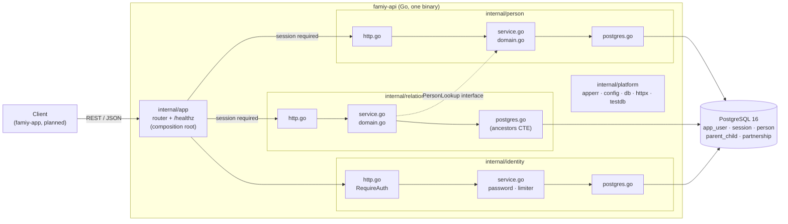

# Architecture Overview — Family Graph

_Last updated: 2026-11-09. Describes what is **implemented** in `famiy-api/` unless marked
**planned**. Decisions and their evidence live in `02—ARCHITECTURE_DECISIONS.md`._

## Shape
A modular monolith: one Go binary, one PostgreSQL database. Modules are packages under
`famiy-api/internal/`; layering is by file within each module, not by subfolder.

## Modules and boundaries
| Module | Owns | Depends on |
|---|---|---|
| `internal/identity` | Accounts, argon2id passwords, server-side sessions, failed-login limiter, `RequireAuth` (ADR-004) | `platform` |
| `internal/person` | Person model, validation, create/get/update/delete/search, **scoped to an owner**; the per-account person cap | `platform` |
| `internal/graph` | Read model for rendering: `GET /graph` returns an account's people, parent links and partnerships from one snapshot. Query side only | `platform`. **Exception to rule 2 below:** it reads the person, `parent_child` and `partnership` tables directly rather than through the other modules, because three separate calls could not share a snapshot |
| `internal/relationship` | `parent→child` links, partnerships (closed set of kinds, pair accepted in either order), invariants, derived kinship: ancestors, descendants, siblings, closest-common-ancestor relationship | `platform`; `person` only through the small `PersonLookup` interface |
| `internal/platform` | `apperr` (error kinds), `config`, `db` (pgx pool), `httpx` (JSON, error→status mapping, middleware), `testdb` (test helper) | nothing in the app |
| `internal/app` | Wiring, router, `/healthz`; puts every non-auth route behind `RequireAuth` and injects "who is calling" into handlers | all modules |
| `cmd/server` | Process entrypoint: config, logging, pool, graceful shutdown | `app`, `platform` |

## Rules that keep it simple
1. **The domain imports neither `net/http` nor pgx.** Handlers use separate request/response
   structs; pgx and SQL types never leave a module's `postgres.go`.
2. **Repository interfaces live beside their consumer** (the service). ADR-001 keeps the
   traversal mechanism swappable behind this boundary.
3. **One place maps errors to HTTP.** Domain code returns `apperr` values (`Invalid`,
   `NotFound`, `Conflict`) with a stable code; `httpx.Error` picks the status. Anything else is
   logged and returned as an opaque 500.
4. **Invariants live in the database too.** The domain gives fast, friendly errors; CHECK/PK/
   trigger constraints are the backstop, and Postgres SQLSTATEs are translated back into
   domain errors.
5. **Context flows down** from the request to every pgx call.
6. **Ownership is an explicit parameter, never ambient.** Services take `ownerID`; repositories
   filter by it; feature modules receive "who is calling" through an injected `httpx.OwnerFunc`
   and never import `identity`. The database repeats the rule (`same_owner`) as a backstop.

## Request path (example: `GET /persons/{id}/ancestors`)
`chi` router → middleware (request id, request log, panic safety net, Origin check, JSON-only)
→ `RequireAuth` (cookie → session → account, else 401) → `relationship` handler (account id
via the injected `OwnerFunc`, parse id) → `relationship.Service` (confirms the person exists
**and belongs to that account** via `PersonLookup`; otherwise 404) → `PgRepository.Ancestors`
(recursive CTE, ADR-001) → JSON response, or an `apperr` mapped by `httpx.Error`.

## Runtime and tooling
- **Local:** `make dev` runs Postgres 16 in Docker (host port 5433) and the API on the host;
  `make up` runs both in containers (`deploy/docker-compose.yml`).
- **Config:** environment variables only: `DATABASE_URL`, `HTTP_ADDR`, `LOG_LEVEL`, `MAX_PERSONS_PER_ACCOUNT`, plus the
  auth settings `REGISTRATION_ENABLED`, `MAX_USERS`, `SESSION_TTL`, `COOKIE_SECURE`,
  `ALLOWED_ORIGINS`, `TRUSTED_PROXIES` (see `famiy-api/.env.example`). Unsafe combinations log
  startup warnings.
- **CI:** `.github/workflows/api-ci.yml` (build, vet, golangci-lint, `go test -race` with a
  Postgres service container, Docker image build). Green on the Phase 4 final commit.
- **Deployed:** nothing yet. Caddy/TLS and a migration step are deploy-phase work.

## Frontend (`famiy-app/`)
**Implemented (2026-11-10): sign-in, the read-only graph, name search and the person panel. Not yet built:
editing, culling for large trees.** React + TypeScript, Vite, Vitest. The browser is same-origin with the dev
server, which proxies `/api/*` to this API. The path (ADR-002, ADR-005): `GET /graph` through TanStack Query
→ `buildFamilyGraph` (unions from partnerships and shared children) → a pure layout function that runs ELK
(`layered`, union nodes, couple containers) in a Web Worker → a custom React + SVG renderer with pan, zoom,
selection and keyboard movement. Domain state and view state (viewport, selection) are kept apart. Search
filters the people already in the graph (no request per keystroke); the person panel shows the summary and
relatives from the graph and fetches only `GET /persons/{id}` for the bio and residence.

## Not built yet (planned)
Email verification and password reset, the frontend's features (auth shell, graph, search, editing),
photos, and a per-tree ownership model (ownership is per account for now, ADR-004).
