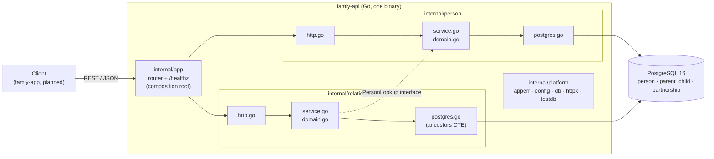

# Architecture Overview — Family Graph

_Last updated: 2026-11-01. Describes what is **implemented** in `famiy-api/` unless marked
**planned**. Decisions and their evidence live in `02—ARCHITECTURE_DECISIONS.md`._

## Shape
A modular monolith: one Go binary, one PostgreSQL database. Modules are packages under
`famiy-api/internal/`; layering is by file within each module, not by subfolder.

## Modules and boundaries
| Module | Owns | Depends on |
|---|---|---|
| `internal/person` | Person model, validation, create/get | `platform` |
| `internal/relationship` | `parent→child` links, invariants, ancestors traversal (partnership edges: **planned**) | `platform`; `person` only through the small `PersonLookup` interface |
| `internal/platform` | `apperr` (error kinds), `config`, `db` (pgx pool), `httpx` (JSON, error→status mapping, middleware), `testdb` (test helper) | nothing in the app |
| `internal/app` | Wiring, router, `/healthz` | all modules |
| `cmd/server` | Process entrypoint: config, logging, pool, graceful shutdown | `app`, `platform` |

## Rules that keep it simple
1. **The domain imports neither `net/http` nor pgx.** Handlers use separate request/response
   structs; pgx and SQL types never leave a module's `postgres.go`.
2. **Repository interfaces live beside their consumer** (the service). ADR-001 keeps the
   traversal mechanism swappable behind this boundary.
3. **One place maps errors to HTTP.** Domain code returns `apperr` values (`Invalid`,
   `NotFound`, `Conflict`) with a stable code; `httpx.Error` picks the status. Anything else is
   logged and returned as an opaque 500.
4. **Invariants live in the database too.** The domain gives fast, friendly errors; CHECK/PK/
   trigger constraints are the backstop, and Postgres SQLSTATEs are translated back into
   domain errors.
5. **Context flows down** from the request to every pgx call.

## Request path (example: `GET /persons/{id}/ancestors`)
`chi` router → middleware (request id, request log, panic safety net) → `relationship`
handler (parse id) → `relationship.Service` (confirms the person exists via `PersonLookup`)
→ `PgRepository.Ancestors` (recursive CTE, ADR-001) → JSON response, or an `apperr` mapped
by `httpx.Error`.

## Runtime and tooling
- **Local:** `make dev` runs Postgres 16 in Docker (host port 5433) and the API on the host;
  `make up` runs both in containers (`deploy/docker-compose.yml`).
- **Config:** environment variables only (`DATABASE_URL`, `HTTP_ADDR`, `LOG_LEVEL`).
- **CI:** `.github/workflows/api-ci.yml` (build, vet, golangci-lint, `go test -race`, with a
  Postgres service container). Written; its first GitHub run is not yet confirmed.
- **Deployed:** nothing yet. Caddy/TLS and a migration step are deploy-phase work.

## Not built yet (planned)
Authentication (undecided), partnership endpoints, person update/delete/search, the
`famiy-app` frontend (React + TypeScript; elkjs layout + SVG per ADR-002), photos, residence,
and a per-tree ownership model.
